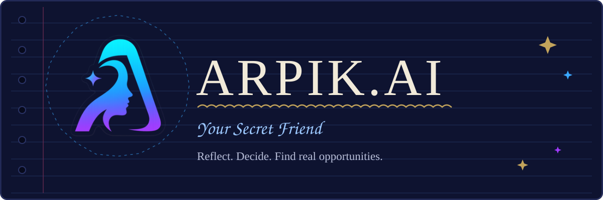
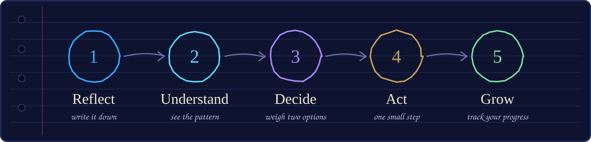
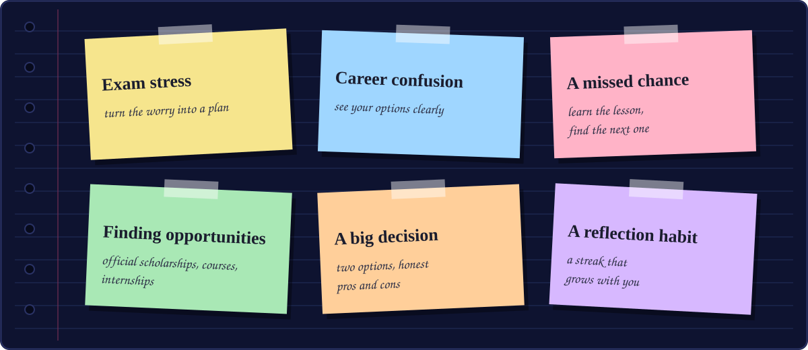

 

# ARPIK.AI
### Your Secret Friend

**A free reflection and decision-support companion for students.**
It does not tell you what to do. It helps you understand yourself well enough to decide.

 

[**Open ARPIK.AI**](https://arpitprk89.github.io/arpik.ai/) · [**Watch the documentary**](https://arpitprk89.github.io/Arpik.ai-documentary/) · [Features](#features) · [Hindi guide](#hindi-guide) · [Feedback](#feedback) · [Creator](#about-the-creator)

 

*Version 1.0 · Free · No sign-up · Works on any modern browser*

 

## Why ARPIK.AI exists

During coaching, Arpit noticed something. Amid a crowd of students, each person carries their own pressure, expectations and story, yet marks are often the only thing that gets seen. Being in a crowd and being understood are two different things.

That raised a question: what if AI were used not only to give answers, but to help a student understand their own situation and find real opportunities?

ARPIK.AI is the attempt to answer that question. It asks the questions that turn a feeling into a plan: **what happened, why, what pattern is behind it, what did I learn, and what is my next small step.** Then it points you to real, official opportunities. The decision always stays with you.

The full story is told in the documentary: **[Arpik.ai Documentary](https://arpitprk89.github.io/Arpik.ai-documentary/)** (English and Hindi).

 

## How it works

 

## Features

Every function exists because of something a student needs and rarely gets.

| Feature | Why it exists | What it does |
|:---|:---|:---|
| **Reflect** | Regret and worry often stay unspoken. | Four guided questions end in a card: Regret, Reason, Pattern, Lesson and Next step. Optional mood check-in. |
| **Talk** | Sometimes you only need someone to listen at the right moment. | AI chat in any language. Voice input in 12 languages and read-aloud for replies. |
| **Radar** | Many students never hear about the opportunities meant for them. | 17 official platforms for scholarships, internships, free courses, coding and exams. Save one, add the deadline you found, and the app counts the days. |
| **Decide** | A score should not choose a life for you. You should. | Enter two options with pros and cons. You get uncertainties, consequences and questions to ask yourself. It never picks for you. |
| **Growth** | Progress stays invisible when only marks are counted. | Streak, mood graph, common reasons, your lessons and a next-step checklist. |
| **Lesson card** | A lesson becomes real when you can hold it. | Turns a lesson into a shareable image. |
| **Feedback** | This is a young project and students should shape what comes next. | Sends your message to the creator by email. |
| **Private by design** | Honest reflection needs a safe place. | Reflections stay on your device. Optional app PIN. Download or delete your data any time. |
| **Install as an app** | It should be easy to reach, even on a weak connection. | Works like an app on your phone, and the basics work offline. |

Each section of the app has its own dark colour, so you always know where you are.

 

## How to use it (step by step)

1. **Open the app** and tap *Enter*.
2. **Reflect.** Pick your mood (optional), write what is on your mind in any language, choose the closest reason (fear, lack of information, delay, priorities), and say what could change now. You get a *Regret → Reason → Pattern → Lesson → Next step* card.
3. **Save a lesson card.** Tap *Save lesson card* to get a shareable image. Leave out private details if you plan to share it.
4. **Talk.** Chat with the AI in any language. Use the mic button to speak and the speaker button to hear a reply.
5. **Radar.** Pick what you are looking for, open the official site, save the opportunity and add the deadline you found there.
6. **Decide.** Enter a decision and two options with pros and cons. Read the questions, then choose for yourself.
7. **Growth.** See your streak, mood trend, common reasons, lessons and next steps. Tick a step when you finish it.
8. **Feedback.** Tell the creator what worked and what did not.

 

## Where it helps

 

## How the AI works

ARPIK.AI uses a free online AI service ([Pollinations](https://pollinations.ai)) to write replies. It tries several models and retries when one is busy. If none respond, the app shows a simple guided summary and official links, so you are never left with an empty screen.

AI answers can be imperfect. Treat them as a thinking aid, not as advice from an expert.

 

## Privacy and safety

- **Your reflections are stored only on your own device.** ARPIK.AI does not save chats on any server.
- Text sent for an AI reply goes to a free third-party AI service (Pollinations). Do not write anything you would not want sent online.
- The **app PIN** is a casual lock that hides the app from people using your phone. Data on the device is not encrypted.
- **ARPIK.AI is not a therapist and not an emergency service.** It is not a replacement for a counsellor, a trusted adult or real human support. If someone writes about hurting themselves, the app shows a support message with **Tele-MANAS 14416** (India, free, 24x7) and **112** for emergencies.
- The **Feedback** form sends your message by email through a free form service. Please do not write private details from your reflections there.
- Always check dates and eligibility for opportunities on the official website.

 

## Install on your phone

- **Android (Chrome):** open the link, tap the ⋮ menu, then *Install app* or *Add to Home screen*.
- **iPhone (Safari):** open the link, tap *Share*, then *Add to Home Screen*.

 

## Run or host it yourself

ARPIK.AI is a static website with no build step.

**The app**

1. Put these files in a GitHub repository: `index.html`, `manifest.webmanifest`, `sw.js`, `icon-192.png`, `icon-512.png`, `icon-maskable-512.png`, `apple-touch-icon.png`, `arpik-ai.png`.
2. Open **Settings → Pages**, choose *Deploy from a branch*, branch `main`, folder `/ (root)`, and save.
3. After a minute your site is live at `https://<your-username>.github.io/<repo-name>/`.

**The documentary**

The documentary is a single self-contained file, `index.html`, kept in its own repository ([Arpik.ai-documentary](https://arpitprk89.github.io/Arpik.ai-documentary/)). Host it the same way. To change the button link at the end, edit the `U` value in the script.

**Feedback form**

The Feedback form uses [FormSubmit](https://formsubmit.co). The first message triggers an activation email to the receiving address. Click the link once and it works from then on.

 

## Known limits (version 1.0)

- The free online AI can be slow or busy. Answers can be imperfect.
- The opportunity list is small (17 official platforms) and does not show live deadlines. You add dates yourself.
- Voice input depends on your browser and device, and is weaker in some languages.
- This is a young project. Feedback is what decides what comes next.

 

## Feedback

Open the **Feedback** tab inside the app, or write to **arpitpareek79@gmail.com**.

 

## Hindi guide

**ARPIK.AI क्या है?**
विद्यार्थियों के लिए एक मुफ़्त AI साथी, जो आपके पछतावे, तनाव और उलझनों को समझने और अपना फ़ैसला ख़ुद लेने में मदद करता है। यह आपके लिए फ़ैसला नहीं करता।

**यह क्यों बना?**
कोचिंग की भीड़ में हर विद्यार्थी का अपना दबाव और अपनी कहानी होती है, पर अक्सर सिर्फ़ अंक देखे जाते हैं। भीड़ में होना और समझा जाना, दो अलग बातें हैं। इसी सवाल से ARPIK.AI की शुरुआत हुई। पूरी कहानी डॉक्यूमेंट्री में है: [Arpik.ai Documentary](https://arpitprk89.github.io/Arpik.ai-documentary/)।

**हर हिस्से का काम**
| हिस्सा | क्या करता है |
|:---|:---|
| **Reflect** | चार सवालों के बाद पछतावा, कारण, पैटर्न, सीख और अगला कदम वाला कार्ड |
| **Talk** | किसी भी भाषा में AI से बात, बोलकर भी (12 भाषाएँ), और जवाब सुन भी सकते हैं |
| **Radar** | छात्रवृत्ति, इंटर्नशिप, फ़्री कोर्स और परीक्षाओं के 17 आधिकारिक लिंक, और आपकी आख़िरी तारीख़ की गिनती |
| **Decide** | दो विकल्पों के फ़ायदे-नुक़सान, अनिश्चितताएँ और ख़ुद से पूछने लायक़ सवाल। चुनाव आप ही करते हैं |
| **Growth** | streak, मूड का ग्राफ़, आपकी सीखें और अगले कदमों की सूची |
| **Lesson card** | अपनी सीख को साझा करने लायक़ तस्वीर बनाएँ |
| **Feedback** | अपने सुझाव सीधे निर्माता को भेजें |

**कैसे इस्तेमाल करें**
1. ऐप खोलें और *Enter* दबाएँ।
2. **Reflect** में अपनी बात किसी भी भाषा में लिखें। आपको कारण, पैटर्न, सीख और अगला कदम मिलेगा।
3. **Talk** में AI से बात करें, 🎤 से बोलकर भी।
4. **Radar** में आधिकारिक लिंक देखें और अपनी आख़िरी तारीख़ जोड़ें।
5. **Decide** में दो विकल्पों के फ़ायदे-नुक़सान देखें।
6. **Growth** में अपनी प्रगति देखें।

**ज़रूरी बातें:** आपकी लिखी बातें आपके अपने फ़ोन में रहती हैं। AI के जवाब के लिए लिखा गया टेक्स्ट एक मुफ़्त AI सेवा तक जाता है। यह थेरेपिस्ट या काउंसलर का विकल्प नहीं है। गंभीर परेशानी में किसी भरोसेमंद इंसान से बात करें या **टेली-मानस 14416** (मुफ़्त, 24x7) पर कॉल करें। आपातकाल में **112**।

 

## About the creator

Built by **Arpit Pareek**, a Class XII student from Shrimadhopur, Rajasthan, son of Shri Bajrang Pareek and Smt. Samta Devi.

[Mail](mailto:arpitpareek79@gmail.com) · [LinkedIn](https://www.linkedin.com/in/arpit-pareek-83b533361/) · [English Project Hub](https://arpitprk89.github.io/projects-in-eng-/) · [GitHub](https://github.com/arpitprk89)

 

*Built from experience. Guided by empathy. Driven by possibility.*

*A small step towards a bigger vision.*

